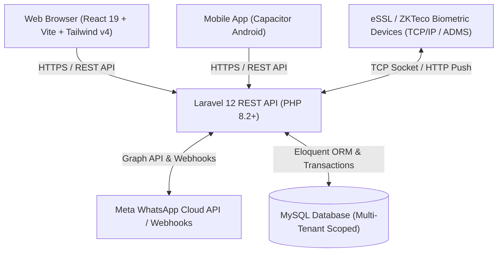
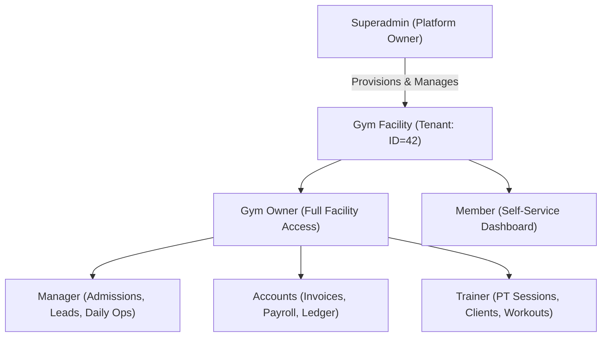
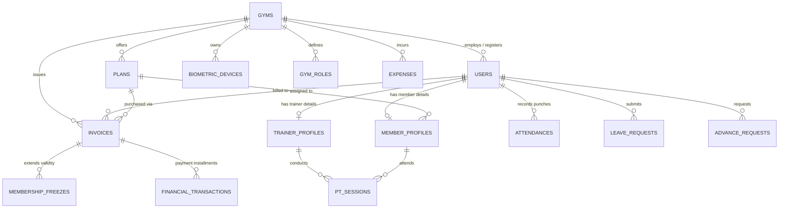

# PulseFit / ArchFit — Enterprise Gym Management & SaaS Platform
## Comprehensive Product & IT Technical Documentation

---

### Document Control & Metadata
- **Product Name**: PulseFit / ArchFit Gym Management SaaS
- **Document Version**: 2.4.0 (Enterprise Edition)
- **Target Audience**: CTOs, IT Directors, Solution Architects, DevOps Engineers, Full-Stack Developers, Product Managers
- **Classification**: Confidential / Enterprise Documentation
- **Last Updated**: October 2026

---

## 1. Executive Summary & Product Overview

**PulseFit (ArchFit)** is an end-to-end, multi-tenant cloud SaaS and mobile application engineered for modern fitness clubs, gym franchises, crossfit boxes, and personal training studios. The platform bridges the gap between hardware IoT (biometric access control devices), financial accounting (GST-compliant multi-mode invoicing & payroll), member lifecycle engagement (automated WhatsApp CRM & progress tracking), and enterprise franchise administration.

### Key Value Propositions
1. **Multi-Tenant Club Isolation**: Complete data and operational separation across independent gym facilities, supported by a Superadmin SaaS control plane.
2. **Hardware IoT Biometric Integration**: Native support for eSSL and ZKTeco biometric attendance machines via raw TCP/IP socket sync and HTTP ADMS push server protocols.
3. **Financial & Compliance Engine**: GST-compliant invoice generation, partial payments, automated due reminders, membership plan chaining, and trainer commission splits.
4. **Autonomous WhatsApp CRM**: Event-driven automated messaging for admissions, fee receipts, payment dues, membership expiry, and birthday alerts without third-party portal logins.
5. **Human Resources & Payroll**: Automated shift scheduling, leave approval quotas, advance pay management, and automated salary slip generation.
6. **Cross-Platform Accessibility**: Modern, responsive web application paired with Android mobile capability via Capacitor.



---

## 2. Technology Stack & Specifications

### 2.1. Frontend Architecture
| Layer | Technology | Version | Purpose |
| :--- | :--- | :--- | :--- |
| **Framework** | React | `19.2.8` | Declarative UI component architecture |
| **Bundler / Dev Server** | Vite | `8.2.2` | High-speed ESM build tool & hot reload |
| **CSS & Design System** | Tailwind CSS | `4.3.3` | Utility-first responsive design system with CSS variables |
| **Iconography** | Lucide React | `0.475.0` | Comprehensive SVG icon library |
| **Data Visualization** | Recharts | `3.10.1` | Financial, attendance & growth interactive charts |
| **Document Generation** | jsPDF | `4.2.1` | Client-side dynamic PDF invoice and receipt rendering |
| **Mobile Runtime** | Capacitor (Android) | `8.5.1` | Cross-platform mobile bridge for Android APK distribution |
| **State & Context** | React Context API | Native | AuthContext, GymDataContext, Theme, Toast notifications |
| **Code Linter** | Oxlint | `1.79.0` | High-performance JavaScript/JSX linter |

### 2.2. Backend Architecture
| Layer | Technology | Version | Purpose |
| :--- | :--- | :--- | :--- |
| **Runtime** | PHP | `^8.2` | High-performance server-side scripting language |
| **Web Framework** | Laravel Framework | `12.0` | Enterprise MVC application framework |
| **Authentication** | Laravel Sanctum | `^4.0` | Token-based stateless API authentication |
| **Database ORM** | Eloquent ORM | Built-in | Active Record data modeling & relation mapping |
| **Database Engine** | MySQL / MariaDB | `8.0+` | Relational storage engine with `utf8mb4` charset |
| **PDF Generation** | Custom Service & jsPDF | Hybrid | Server-side and client-side thermal & A4 invoice generation |
| **Task Queue** | Laravel Queue Worker | Built-in | Asynchronous job processing for notifications and batch sync |

### 2.3. Hardware & External Integrations
- **Biometric Access Control**:
  - Protocols: Direct TCP socket sync (Port 4370) & HTTP ADMS cloud push server.
  - Compatible Brands: eSSL, ZKTeco, Realtime, BioMax.
- **WhatsApp Automation**:
  - Integration: Meta WhatsApp Cloud API (Graph API v18+) & Webhook receivers.
- **Storage / CDN**:
  - Local disk storage with public symlink (`/storage/app/public`) & Base64 support for offline sync.

---

## 3. Multi-Tenant Architecture & Role-Based Access Control (RBAC)

### 3.1. Tenant Isolation Model
The application implements **Shared Database, Scoped Tenant Isolation**:
- Every operational table includes an indexed `gym_id` foreign key referencing the `gyms` table.
- Non-superadmin requests resolve the current tenant via `$request->user()->gym_id` or query header verification.
- Database queries across members, staff, invoices, attendance, and settings are strictly scoped to the active tenant.
- Gym Owners can only access data belonging to their provisioned facility.



### 3.2. Role Hierarchy & Access Matrix

| Feature / Page Slug | Superadmin | Gym Owner | Manager | Accounts | Trainer | Member |
| :--- | :---: | :---: | :---: | :---: | :---: | :---: |
| **Platform SaaS Dashboard** | ✅ | ❌ | ❌ | ❌ | ❌ | ❌ |
| **Gym Provisioning & SaaS Tiers** | ✅ | ❌ | ❌ | ❌ | ❌ | ❌ |
| **Club Owner Dashboard** | ❌ | ✅ | Configurable | Configurable | ❌ | ❌ |
| **Member Directory & KYC** | ❌ | ✅ | ✅ | ✅ | ❌ | ❌ |
| **Add Member & Onboarding** | ❌ | ✅ | ✅ | ✅ | ❌ | ❌ |
| **Invoices & GST Receipts** | ❌ | ✅ | ✅ | ✅ | ❌ | View Own |
| **Record Payment & Dues** | ❌ | ✅ | ✅ | ✅ | ❌ | ❌ |
| **Membership Freeze & Transfer** | ❌ | ✅ | ✅ | ✅ | ❌ | ❌ |
| **Attendance & Biometric Sync** | ❌ | ✅ | ✅ | ✅ | ❌ | View Own |
| **Class Schedules & Bookings** | ❌ | ✅ | ✅ | ✅ | ✅ | Book Classes |
| **PT Sessions Tracker** | ❌ | ✅ | ✅ | ✅ | Log PT | View Own |
| **Workout & Diet Builder** | ❌ | ✅ | ❌ | ❌ | ✅ | View Assigned |
| **Staff & Shifts Management** | ❌ | ✅ | ❌ | ✅ | ❌ | ❌ |
| **Leaves & Advance Pay** | ❌ | ✅ | ❌ | ✅ | Request Own | ❌ |
| **Payroll & Trainer Commissions** | ❌ | ✅ | ❌ | ✅ | View Own | ❌ |
| **WhatsApp Templates & Rules** | ❌ | ✅ | ✅ | ✅ | ❌ | ❌ |
| **Club Settings & Hardware Setup** | ❌ | ✅ | ❌ | ✅ | ❌ | ❌ |

### 3.3. Dynamic Custom Role Builder (`gym_roles`)
In addition to fixed roles, Gym Owners can define **custom staff roles** (e.g., *Receptionist*, *Floor Supervisor*, *Head Coach*):
- Each role is assigned a custom name, badge color, and a granular array of `assigned_pages`.
- Navigation menus and route guards dynamically evaluate the staff member’s `assigned_pages` on login.

---

## 4. Comprehensive Functional Modules

### 4.1. Authentication & Identity Management
- **Multi-Identifier Login**: Users authenticate using their 10-digit mobile number, email address, or username.
- **Session Security**: Stateless bearer tokens via Laravel Sanctum with customizable expiration and automatic invalidation on logout.
- **Password Masking & Initial Passwords**: Superadmin and Owners can provision staff accounts with an initial password and trigger a mandatory password reset on first login (`must_change_password`).
- **Biometric Hardware Identifier**: Each user profile stores a synchronized `biometric_user_id` mapping 1:1 to hardware attendance devices.

### 4.2. Member Lifecycle & KYC Directory
- **Onboarding Workflow**: Capture full demographics, photo avatar, Aadhaar / National ID, PAN card, date of birth, emergency contact, blood group, and medical history.
- **Membership Chaining (Future Renewals)**:
  - Supports queuing a new plan before the current active plan expires.
  - Automatically calculates start date chaining (`chain_after_previous_plan = true`).
- **Member Status Engine**: Active, Expired, Suspended, Frozen, Trial, and Inactive states with visual badge indicators.
- **Audit Notes & Profile Log**: Staff can append dated operational notes to member profiles.

### 4.3. Plans, Offers & Membership Management
- **Flexible Plan Configuration**: Regular gym memberships, student discounts, couple packages, off-peak access, and 1-on-1 Personal Training (PT) packages.
- **Session-Based Plans**: Define total PT sessions with expiry periods.
- **Promotional Offers & Grace Periods**:
  - Add bonus offer days (e.g., "+15 days free on annual plan").
  - Configurable grace days before an expired member is flagged by biometric turnstiles.

### 4.4. Point of Sale (POS), Invoicing & Financial Accounting
- **GST-Compliant Tax Invoices**:
  - Itemized breakdowns for Admission Fees, Plan Charges, Personal Training, and Locker/Merchandise fees.
  - Tax calculation options: Inclusive GST, Exclusive GST (CGST + SGST or IGST), or Non-Taxable.
  - Support for custom Gym GSTIN and State Code.
- **Multi-Mode Payment Tracking**:
  - Supports UPI (PhonePe, GPay, Paytm), Credit/Debit Card, Cash, and Net Banking.
  - Split / Partial payments with automated remaining due date calculation.
- **Receipt & Invoice PDF Engine**:
  - Dual format rendering: Standard A4 Invoice and 80mm / 58mm Thermal Receipt format.
  - Custom gym branding, logo, header, terms, and digital authorized signature.

### 4.5. Biometric IoT Attendance System
- **Real-Time Punch Sync**:
  - Direct socket listener connects to eSSL/ZKTeco devices over local LAN or static IP WAN.
  - Cloud ADMS push controller receives punches via HTTP POST directly from device firmware.
- **Automated Check-in / Check-out Calculation**:
  - Automatically pairs punch-in and punch-out timestamps to determine total hours spent in the facility.
- **Biometric Device Registry & Health Monitoring**:
  - Register multiple biometric devices per gym (e.g., Turnstile In, Turnstile Out, Staff Door).
  - Track last ping, connection state (Online / Offline), and device firmware info.
- **Biometric Deletions Tracking**:
  - When a member is deleted or expired, deletion sync records ensure hardware devices remove biometric fingerprints/faces to prevent unauthorized entry.

### 4.6. Operations: Freeze, Transfers & Consent Forms
- **Membership Freeze Policy**:
  - Enforce max freeze days and max allowed freeze requests per plan cycle.
  - Distinguish between Medical Freeze (requiring doctor certificate upload) and Personal Freeze.
  - Automatically extends invoice end dates and member expiration by the frozen duration.
- **Membership Transfer Workflow**:
  - Transfer remaining membership balance from one member to another with transfer fee calculation.
- **Digital Consent Forms & Waivers**:
  - Customizable gym waiver templates (Liability Waiver, Covid-19 Undertaking, PT Agreement).
  - Member signature capture and timestamped PDF archiving.

### 4.7. HR, Staff & Employee Payroll
- **Shift Timings & Slots**: Create morning, evening, and split shifts with assigned grace arrival windows.
- **Leave Management**: Leave categories (Casual, Sick, Paid), annual leave quotas, balance deduction, and approval pipeline.
- **Advance Salary Requests**:
  - Staff request advance salary with justification.
  - Automated deduction from subsequent monthly payroll calculation.
- **Employee Payroll Generation**:
  - Computes base salary, attendance deductions, unpaid leave penalties, advance pay repayments, and bonuses.
  - Generates downloadable salary slips.
- **Trainer Commission Tracking**:
  - Automatic calculation of trainer commissions for PT packages sold or sessions delivered (percentage-based or flat rate).

### 4.8. Fitness, Coaching & Nutrition
- **PT Session Logger**:
  - Digital logging of conducted PT sessions with member acknowledgement.
  - Real-time remaining sessions balance counter.
- **Workout Plan Builder**:
  - Day-by-day split (Chest, Back, Legs, Core, Cardio) with exercise name, sets, reps, weight targets, and rest timers.
- **Diet & Nutrition Builder**:
  - Meal breakdowns (Breakfast, Snack 1, Lunch, Pre-Workout, Post-Workout, Dinner).
  - Macro calculations: Protein (g), Carbs (g), Fats (g), and Total Calories (kcal).
- **Body Transformation Tracker**:
  - Periodic logging of Weight, Body Fat %, Chest, Biceps, Waist, Hips, and Thighs with visual progress graphs.

### 4.9. Class Schedules & Batch Bookings
- **Group Classes**: Yoga, Zumba, HIIT, Spinning, CrossFit, and Martial Arts.
- **Capacity Management**: Maximum class seats limit to prevent overcrowding.
- **Member Self-Booking**: Members can reserve, cancel, and view class attendee rosters.

### 4.10. CRM, Enquiries & Lead Pipeline
- **Visual Lead Pipeline**: Kanban and list view stages:
  - `New Lead` ➔ `Follow-Up Scheduled` ➔ `Trial Booked` ➔ `Converted to Member` ➔ `Lost`.
- **Source Attribution**: Track leads from Walk-in, Instagram, Google Maps, Referral, or Website.
- **Quick Conversion**: 1-click conversion from enquiry directly into Member Onboarding with prepopulated details.

### 4.11. WhatsApp Automation & Notifications
- **Event-Driven Auto Triggers**:
  1. *Welcome Message*: Triggered immediately upon member registration with member ID and app download link.
  2. *Payment Receipt*: Triggered on payment recording with amount paid, balance due, and PDF receipt link.
  3. *Payment Due Reminder*: Automated reminder dispatched X days prior to due date.
  4. *Membership Expiry Alert*: Dispatched 7 days, 3 days, and 1 day prior to plan end date.
  5. *Birthday Greetings*: Automated warm wishes dispatched on the member's birthday.
- **Custom Broadcast Messages**: Send announcements (holiday notices, batch timing updates) to all active members or filtered cohorts.
- **WhatsApp Webhook Receiver**: Captures delivery status (Sent, Delivered, Read, Failed).

### 4.12. Financial Reports & Business Analytics
- **Executive KPI Dashboard**: Total active members, monthly recurring revenue (MRR), total revenue collected, outstanding dues, and attendance counts.
- **Expense Tracker**: Categorize daily club operational expenses (Rent, Electricity, Maintenance, Supplement Inventory, Marketing).
- **Profit & Loss Ledger**: Real-time net income calculation (Total Receipts minus Total Operating Expenses).
- **Exporting**: 1-click export of financial reports and member rosters to Excel/CSV.

### 4.13. Superadmin SaaS Control Plane
- **SaaS Package Tiering**: Manage tiered subscription plans (Bronze, Silver, Gold, Platinum, Enterprise) with customizable member limits and feature flags.
- **Gym Tenant Provisioning**: Create new gym facilities, set package tier, configure billing cycles, and assign owner credentials.
- **Page & Feature Gating**: Enable or disable specific pages/features per gym facility with immediate UI synchronization.
- **Emergency Suspension**: Instant suspension toggle to block facility access upon subscription expiration.

---

## 5. Database Schema & Data Models

The database contains **44 Eloquent entities**. Below is the core Entity-Relationship diagram illustrating key operational relationships:



### Key Database Tables Overview

| Table Name | Primary Purpose | Key Fields |
| :--- | :--- | :--- |
| `gyms` | Multi-tenant club facilities | `id, name, owner_id, package_tier, currency, status, invoice_settings` |
| `users` | Master authentication & accounts | `id, gym_id, name, email, phone, role, password, biometric_user_id` |
| `gym_roles` | Granular custom staff roles | `id, gym_id, name, slug, assigned_pages, color, is_default` |
| `member_profiles` | Member KYC & fitness data | `id, user_id, plan_id, trainer_id, emergency_contact, blood_group, status` |
| `trainer_profiles`| Coach specialties & salary | `id, user_id, specialty, experience, monthly_salary, rating, certifications` |
| `plans` | Membership packages & PT | `id, gym_id, name, price, duration_days, type, total_sessions, offers` |
| `invoices` | Billing ledger & GST receipts | `id, gym_id, user_id, invoice_number, total_amount, paid_amount, pending_amount, status`|
| `financial_transactions`| Installment payments | `id, invoice_id, amount, payment_mode, transaction_reference, recorded_by`|
| `attendances` | Daily punch logs | `id, gym_id, user_id, date, check_in, check_out, method, device_id` |
| `biometric_devices` | Hardware machine registry | `id, gym_id, device_name, ip_address, port, protocol, status, last_ping`|
| `membership_freezes`| Freeze requests & validity | `id, gym_id, member_profile_id, start_date, end_date, reason, approved_by`|
| `leave_requests` | Staff leave applications | `id, gym_id, user_id, leave_type, start_date, end_date, status` |
| `payroll` | Monthly salary records | `id, gym_id, user_id, month, year, basic_salary, deductions, net_salary`|
| `whatsapp_templates`| Automated CRM messages | `id, gym_id, template_key, body_text, variables, is_active` |
| `whatsapp_logs` | Communication audit trail | `id, gym_id, recipient_phone, message_type, status, response_payload`|

---

## 6. API Architecture & Key Endpoints Catalog

The application exposes a RESTful API with prefix `/api/v1` (with public routes on `/api`). All protected endpoints require a Sanctum Bearer Token: `Authorization: Bearer <token>`.

### 6.1. Authentication & System Endpoints
| HTTP Method | Endpoint | Description | Access |
| :--- | :--- | :--- | :--- |
| `POST` | `/api/v1/auth/login` | Multi-identifier account login | Public |
| `POST` | `/api/v1/auth/register` | Gym owner registration | Public |
| `POST` | `/api/v1/auth/logout` | Revoke current token | Authenticated |
| `GET` | `/api/v1/auth/me` | Fetch active user profile and permissions | Authenticated |
| `GET` | `/api/setup-database` | Web-based migration & repair runner | Admin Key |
| `GET` | `/api/v1/health` | Service health status check | Public |

### 6.2. Member & Membership Endpoints
| HTTP Method | Endpoint | Description | Access |
| :--- | :--- | :--- | :--- |
| `GET` | `/api/v1/members` | Filtered list of gym members | Staff / Owner |
| `POST` | `/api/v1/members` | Onboard member, assign plan & generate invoice | Staff / Owner |
| `GET` | `/api/v1/members/{id}` | Detailed member profile with history | Staff / Owner |
| `PUT` | `/api/v1/members/{id}` | Update member profile and KYC details | Staff / Owner |
| `DELETE` | `/api/v1/members/{id}` | Soft/hard delete member & queue biometric wipe| Owner |

### 6.3. Invoices, Payments & Financials
| HTTP Method | Endpoint | Description | Access |
| :--- | :--- | :--- | :--- |
| `GET` | `/api/v1/invoices` | List invoices with status & date filters | Staff / Owner |
| `POST` | `/api/v1/invoices` | Create custom / plan invoice | Staff / Owner |
| `POST` | `/api/v1/invoices/{id}/payment` | Record installment or full payment | Staff / Owner |
| `GET` | `/api/v1/invoices/{id}/pdf` | Generate printable PDF invoice | Authenticated |
| `GET` | `/api/v1/expenses` | List gym operational expenses | Owner / Accounts |
| `POST` | `/api/v1/expenses` | Record operational expense item | Owner / Accounts |

### 6.4. Hardware & Biometric Endpoints
| HTTP Method | Endpoint | Description | Access |
| :--- | :--- | :--- | :--- |
| `POST` | `/api/v1/attendance/punch` | Direct biometric punch submission | Hardware / API |
| `GET` | `/api/v1/attendance/sync` | Trigger biometric device synchronization | Staff / Owner |
| `GET` | `/api/v1/biometric/devices` | List registered hardware devices | Staff / Owner |
| `POST` | `/api/iclock/cdata` | ADMS cloud push data receiver | eSSL Firmware |
| `GET` | `/api/iclock/getrequest`| ADMS firmware command poll endpoint | eSSL Firmware |

### 6.5. WhatsApp Automation & CRM
| HTTP Method | Endpoint | Description | Access |
| :--- | :--- | :--- | :--- |
| `GET` | `/api/v1/whatsapp/templates` | Fetch automated message templates | Staff / Owner |
| `PUT` | `/api/v1/whatsapp/templates/{id}` | Update template wording & parameters | Staff / Owner |
| `POST` | `/api/v1/whatsapp/send-custom` | Send ad-hoc message or broadcast | Staff / Owner |
| `POST` | `/api/v1/whatsapp/webhook` | Meta WhatsApp webhook receiver | Meta Servers |

---

## 7. Security, Compliance & Data Governance

### 7.1. Authentication & Token Security
- **Bearer Token Hashing**: Sanctum stores personal access tokens as SHA-256 hashes in `personal_access_tokens`.
- **Password Protection**: Passwords are encrypted using PHP's native `Hash::make()` with Bcrypt work factor 12.
- **Credential Masking**: Plaintext passwords are never returned in staff or member queries (`••••••••` mask applied at controller level).

### 7.2. Injection & Query Protection
- **PDO Prepared Statements**: 100% of database interactions are executed via Eloquent ORM or parameterized PDO statements, preventing SQL injection.
- **Dynamic Schema Checks**: Controllers perform runtime `Schema::hasTable()` and `Schema::hasColumn()` checks to prevent application crashes during zero-downtime database migrations.
- **Strict Data Validation**: Every incoming payload is validated against strict FormRequest or Validator rules (regex phone validation, date boundaries, numeric range constraints).

### 7.3. Network & CORS Policy
- **Configurable Origins**: Explicit CORS origin headers allow frontend domains while blocking unauthorized third-party cross-origin requests.
- **Rate Limiting**: API routes are protected by Laravel's `throttle:api` middleware (60 requests per minute baseline, dynamic throttles on authentication routes to prevent brute force).

---

## 8. Infrastructure, Deployment & DevOps Guide

### 8.1. System Requirements
- **Server**: Linux (Ubuntu 22.04 LTS / 24.04 LTS recommended) or cPanel / Cloud Linux.
- **Web Server**: Nginx (recommended) or Apache with `mod_rewrite`.
- **PHP**: `8.2` or `8.3` with extensions: `pdo_mysql`, `mbstring`, `bcmath`, `xml`, `curl`, `zip`, `gd`, `sockets`.
- **Database**: MySQL 8.0+ or MariaDB 10.6+.
- **Node.js**: Node 18.x or 20.x with npm for frontend builds.

### 8.2. Environment Configuration (.env Reference)
```ini
APP_NAME=PulseFit
APP_ENV=production
APP_DEBUG=false
APP_URL=https://archfit.archenterprises.co.in

# Database Connection
DB_CONNECTION=mysql
DB_HOST=127.0.0.1
DB_PORT=3306
DB_DATABASE=your_database_name
DB_USERNAME=your_database_user
DB_PASSWORD=your_database_password

# Authentication
SANCTUM_STATEFUL_DOMAINS=archfit.archenterprises.co.in
SESSION_DRIVER=database

# WhatsApp Cloud API (Optional / Per-Gym)
WHATSAPP_TOKEN=your_meta_system_user_token
WHATSAPP_PHONE_NUMBER_ID=your_phone_number_id
```

### 8.3. Automated Database Migrations (Zero-Downtime)
For hosting environments without SSH access, migrations can be safely triggered with a secure key:
```
GET https://archfit.archenterprises.co.in/api/setup-database?key=pulsefit_setup_2026
```
For terminal-enabled environments:
```bash
cd /path/to/backend
php artisan migrate --force
php artisan config:cache
php artisan route:cache
```

### 8.4. Frontend Build & Mobile Packaging
```bash
# Web Production Build
cd frontend
npm install
npm run build
# Output generated in frontend/dist ready for deployment to public_html

# Android Native App Build (Capacitor)
npm run cap:build
npm run cap:open
```

### 8.5. Scheduled Tasks (Cron Configuration)
Configure the system crontab to execute Laravel's scheduled commands every minute:
```bash
* * * * * cd /path/to/backend && php artisan schedule:run >> /dev/null 2>&1
```
Scheduled jobs automatically run:
- Daily membership expiration checks and status transitions.
- Daily automated WhatsApp birthday messages and due payment reminders.
- Biometric deletion queue synchronization.

---

## 9. Troubleshooting & Operational Runbook

| Symptom | Root Cause | Resolution |
| :--- | :--- | :--- |
| **HTTP 500: Table 'gym_roles' doesn't exist** | Migrations pending on live database | Visit `/api/setup-database?key=pulsefit_setup_2026` or run `php artisan migrate --force`. |
| **Biometric punch not reflecting** | IP changed or port 4370 blocked by firewall | Verify device IP in Gym Settings -> Biometric Devices. Ensure port 4370 is open on local router. |
| **WhatsApp messages failing** | Meta token expired or template not approved | Re-generate Permanent System User Token in Meta Developer Console; check template naming in WhatsApp Settings. |
| **CORS error on API calls** | Frontend URL mismatch in backend configuration | Update `SANCTUM_STATEFUL_DOMAINS` and `config/cors.php` with the exact frontend origin. |
| **Blank PDF on receipt generation** | Popup blocker or missing image cross-origin | Allow browser popups; ensure gym logo URL is reachable and served with CORS headers. |

---

*End of Technical Documentation. PulseFit / ArchFit Platform Architecture Team.*
